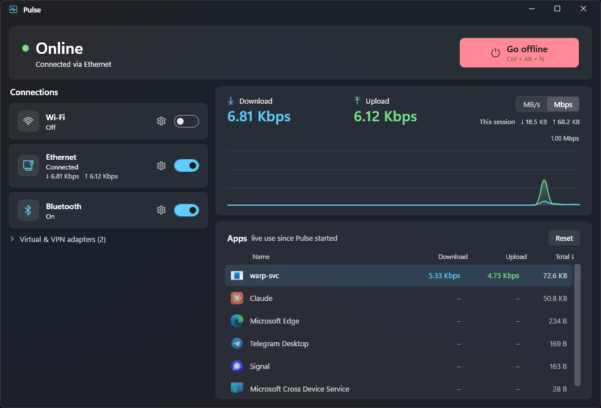

<p align="center">
  
</p>

<h1 align="center">Pulse</h1>

<p align="center"><b>See what your network is doing. Cut it off with one key.</b></p>

<p align="center">
  
  
  
  <a href="../../releases/latest"></a>
</p>

<p align="center">
  
</p>

Pulse is a small tray app for Windows 11. It shows live network usage, per app, and turns Wi-Fi, Ethernet and Bluetooth off and on with a single hotkey.

I made it for gaming on my phone while my laptop shares the connection: press `Ctrl+Alt+N`, the laptop lets go of the network, and the bandwidth is yours. Press it again when you're done.

## Why Pulse

- **One key to go offline.** `Ctrl+Alt+N` from anywhere, or the big button. Going online restores exactly what was on before.
- **Each connection is its own switch.** Wi-Fi, Ethernet and Bluetooth have separate toggles and separate settings.
- **Task Manager, but readable.** Speeds in MB/s or Mbps, a 60-second graph, and a list of which apps are using the network right now.
- **Light.** A native WPF app that sits in the tray and makes no network calls of its own.

## Features

**Go offline / Go online**: Turns off every connection you've included and remembers which ones were on. Going online brings back only those. Works from the window, the tray menu, or the hotkey.

**Connections**: One card per adapter with a switch, live speed and a gear menu. In the gear menu you choose whether that connection takes part in Go offline. For Wi-Fi you can also choose between switching the radio (instant, the default) or disabling the whole adapter.

**Live traffic**: Download and upload speed, session totals and a 60-second graph, in MB/s or Mbps. Only physical Wi-Fi and Ethernet are counted, so a VPN doesn't double the numbers.

**Apps**: Every program that is using the network, with its icon and name, plus current download, upload and total since Pulse started. Click a column header to sort by name, download, upload or total (the default); click again to reverse. Your choice is remembered. Reset clears the counts.

**Tray**: The same toggles from the tray menu. Closing the window hides Pulse to the tray.

VPN and virtual adapters (WARP, Tailscale, Hyper-V and so on) sit in a collapsed section and are left alone by Go offline unless you include them.

## Download

1. Install the [.NET 10 Desktop Runtime](https://dotnet.microsoft.com/download/dotnet/10.0) if you don't have it.
2. Download the latest zip from [Releases](../../releases/latest) and extract it anywhere.
3. Run `Pulse.exe` and accept the admin prompt.

### Requirements

- Windows 11
- .NET 10 Desktop Runtime
- Administrator rights for Ethernet control and per-app usage (see the FAQ)

### Skip the UAC prompt

To launch Pulse as admin without a prompt each time, clone this repo and run this once in an elevated PowerShell from its root (it builds `dist\` first if needed):

```powershell
.\scripts\install.ps1              # adds a Start menu shortcut backed by a scheduled task
.\scripts\install.ps1 -Autostart   # same, and also starts Pulse in the tray at login
```

## Safety and privacy

- Pulse makes no network connections of its own. No account, no telemetry, no update check.
- The only things it changes are adapter and radio state, the same as flipping them in Windows settings.
- Settings live in `%AppData%\Pulse\settings.json`. Nothing else is written.
- If you quit Pulse while offline, your connections stay off. Start it again and press Go online.

## FAQ

**Why does it need admin rights?**
Disabling an Ethernet adapter and reading per-app traffic are both admin-only in Windows. If you decline the prompt, Pulse still runs: Wi-Fi, Bluetooth and the speed graphs work, and the Ethernet toggle and the app list are disabled.

**Will it turn off my Bluetooth mouse or headset?**
Bluetooth is included in Go offline by default, so yes. Untick it in its gear menu to leave it alone.

**Why do the app numbers add up to more than the adapter speed with my VPN on?**
Traffic through a VPN is seen twice, once inside the tunnel and once on the physical adapter. The adapter figure is the real one.

**What counts as an "app"?**
Processes are grouped by executable and shown by their file description, so all Chrome processes appear as one line. Background services show up as "Host Process for Windows Services".

**What happens if Pulse crashes while tracing?**
Windows can leave a trace session behind. Pulse cleans it up on the next start.

## For developers

```powershell
dotnet run -- --no-elevate   # quick run in limited mode (no Ethernet control, no per-app list)
.\scripts\publish.ps1        # ReadyToRun build into .\dist
```

Needs the [.NET 10 SDK](https://dotnet.microsoft.com/download). To test Ethernet control or the app list, run the built `Pulse.exe` and accept the admin prompt.

| Path | What's in it |
| --- | --- |
| `Services.cs` | Adapter listing and switching (radio API and WMI), per-app tracing (ETW) |
| `ViewModels.cs` | Adapter and app view models, the sampling loop, Go offline logic |
| `MainWindow.xaml` | The window layout |
| `Theme.xaml` | Colors and control styles |
| `GraphControl.cs` | The traffic graph |
| `Tray.cs` | Tray icon and menu |
| `Core.cs` | Settings, number formatting, elevation helper |
| `scripts/` | Publish and install scripts |

How it works: Wi-Fi and Bluetooth are switched with the Windows radio API, which is instant and needs no admin rights. Ethernet and other adapters are enabled or disabled through WMI `Win32_NetworkAdapter`. Per-app usage comes from the kernel network ETW provider via [TraceEvent](https://github.com/microsoft/perfview), with loopback traffic ignored. Adapter speeds come from the .NET interface counters, sampled once a second.

Third-party libraries, all MIT: [CommunityToolkit.Mvvm](https://github.com/CommunityToolkit/dotnet), [TraceEvent](https://github.com/microsoft/perfview), System.Management.

## License

[MIT](LICENSE). Use it, change it, ship it. No warranty, no liability. It disables network adapters, so know what you're clicking.
